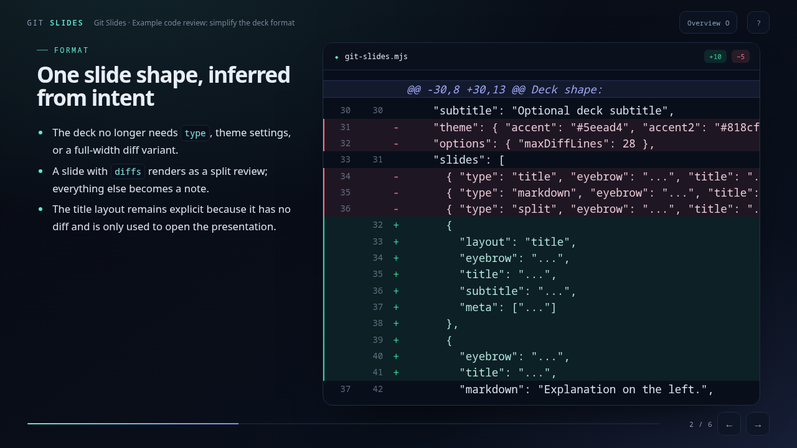
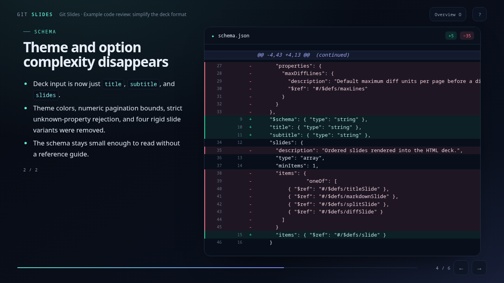

# Git Slides

Turn a pull request or diff into one self-contained HTML presentation for code review. Markdown commentary sits on the left, unified diffs on the right, and long changes paginate automatically.



Long diffs continue across pages without losing their explanation:



[Open the example deck](example.html) · [View example source](example.slides.json)

## Install as an OpenCode skill

```sh
npx skills add tehZevo/git-slides -a opencode -g
```

Restart OpenCode after installing.

## Generate a presentation manually

Requires Node.js, with no package installation needed:

```sh
node git-slides.mjs example.slides.json --out example.html
```

Open `example.html` in any browser. Use arrow keys or space to navigate, `O` for the slide overview, and `?` for help.

## Deck format

Decks are JSON validated by [`schema.json`](schema.json). A slide with `diffs` renders as a split review; omit `diffs` for a full-width note. See [`SKILL.md`](SKILL.md) for the code-review workflow.
